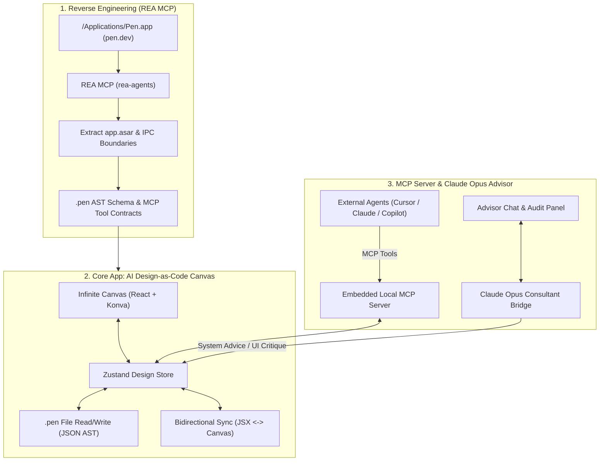

# Implementation Plan: AI Design-as-Code Canvas (Pen.dev Alternative) via REA MCP with Claude Opus Advisor

> **For Claude / Agent:** REQUIRED SUB-SKILL: Use `superpowers:executing-plans` to implement this plan task-by-task.

**Goal:** Reverse-engineer `/Applications/Pen.app` (pen.dev) using REA MCP (`rea-agents`), reconstruct its `.pen` AST format, vector canvas engine, and local MCP interface, and build an open AI-native Design-as-Code canvas application integrated with a **Claude Opus Advisor** for architectural and UX design consultation.

**Architecture:** 
- **Reverse Engineering Layer:** REA MCP CLI & bridge to decompile, map IPC boundaries, inspect `app.asar`, and extract `.pen` AST schemas.
- **Canvas & Design Engine:** Modern Web/Desktop app (React 19 + TypeScript + Vite + Tailwind CSS + Konva/HTML5 Canvas) supporting infinite vector workspace, auto-layout, and `.pen` file bidirectional sync.
- **Embedded MCP Server:** Local JSON-RPC / SSE MCP server exposing canvas manipulation tools (`inspect_canvas`, `insert_component`, `mutate_style`, `export_code`) to external AI coding agents.
- **Claude Opus Advisor:** Dedicated architectural consultation bridge (Anthropic Claude 3 Opus / Claude 3.5 Sonnet / Opus APIs) providing structural critique, UX auditing, and component code generation advice.

**Tech Stack:**
- Reverse Engineering: `rea-agents@6.8.0`, Node.js v26, `asar`, AST parser tools.
- Frontend App: React 19, TypeScript 5.8, Tailwind CSS v4, Lucide React, Zustand, React-Konva / Canvas API.
- Code Generation & AST: Babel Parser, Prettier, Zod (schema validation for `.pen`).
- MCP Server: `@modelcontextprotocol/sdk`, Fastify / Express / stdio bridge.
- AI Advisor: Anthropic SDK (`@anthropic-ai/sdk`), Claude Opus system persona & critique prompts.

---

---

## Detailed Task Breakdown

### Task 1: Environment Setup & REA Reverse Engineering on Pen.app
**Goal:** Setup workspace, install `rea-agents`, register REA MCP, and extract internal schemas, AST structures, and MCP definitions from `/Applications/Pen.app`.

- **Files:**
  - Create: `scripts/dissect-pen.sh`
  - Create: `docs/specs/pen-dev-ast-schema.md`
  - Create: `docs/specs/mcp-protocol-spec.md`
- **Steps:**
  1. Initialize Git repository and project root `package.json`.
  2. Run `rea-agents analyze-javascript-application` and `extract-asar` on `/Applications/Pen.app/Contents/Resources/app.asar`.
  3. Extract `.pen` file specification (schema for document, artboards, layers, components, variants, layout constraints).
  4. Inspect pen.dev's internal MCP server: list registered tools (`get_canvas`, `update_node`, `render_selection`, etc.).
  5. Document exact schemas into `docs/specs/`.
  6. Commit findings: `feat(spec): document reverse-engineered pen.dev AST and MCP protocol`.

---

### Task 2: Scaffold Application Foundation (React + TypeScript + Tailwind)
**Goal:** Create a high-performance web/desktop application shell for the design canvas and advisor interface.

- **Files:**
  - Create: `package.json`
  - Create: `vite.config.ts`
  - Create: `tsconfig.json`
  - Create: `src/main.tsx`
  - Create: `src/App.tsx`
  - Create: `src/index.css`
- **Steps:**
  1. Configure Vite with React, TypeScript, Tailwind CSS, Lucide icons.
  2. Setup application layout: Top menu bar, left component/layer tree, central canvas viewport, right properties inspector, bottom MCP status, floating Advisor drawer.
  3. Run `npm test` / smoke build to verify frontend compiles.
  4. Commit: `chore(scaffold): initialize core frontend application`.

---

### Task 3: `.pen` Document AST & Zod Validation Engine
**Goal:** Implement the strongly-typed document object model representing `.pen` design files.

- **Files:**
  - Create: `src/types/pen-ast.ts`
  - Create: `src/core/schema/pen-validator.ts`
  - Create: `src/core/io/pen-file-handler.ts`
  - Test: `tests/unit/pen-ast.test.ts`
- **Steps:**
  1. Define Zod schemas for `PenNode`, `PenFrame`, `PenShape`, `PenText`, `PenComponent`, and `PenDocument`.
  2. Write unit tests for importing valid `.pen` JSON files and rejecting corrupt schemas.
  3. Implement `readPenFile()` and `writePenFile()` with clean deterministic formatting for Git version control.
  4. Run tests and verify 100% pass.
  5. Commit: `feat(core): implement .pen AST schema and file serializer`.

---

### Task 4: Infinite Vector Canvas Engine (React-Konva / HTML5 Canvas)
**Goal:** Build the interactive design workspace supporting zoom, pan, element creation, bounding-box selection, and drag-and-drop transformation.

- **Files:**
  - Create: `src/components/canvas/InfiniteCanvas.tsx`
  - Create: `src/components/canvas/CanvasNodeRenderer.tsx`
  - Create: `src/components/canvas/SelectionTransform.tsx`
  - Create: `src/store/useCanvasStore.ts`
  - Test: `tests/unit/canvas-store.test.ts`
- **Steps:**
  1. Create Zustand store `useCanvasStore` handling viewport coordinates (`zoom`, `offsetX`, `offsetY`), selected node IDs, undo/redo history stack.
  2. Implement `InfiniteCanvas` with pointer events, wheel zoom, spacebar pan, and infinite grid dot pattern.
  3. Implement `CanvasNodeRenderer` rendering shapes (rect, circle, frame, text) with styling (fill, stroke, radius, shadow, auto-layout flex).
  4. Implement `SelectionTransform` for interactive resizing and rotating.
  5. Write tests for state mutations (adding nodes, moving nodes, deleting nodes).
  6. Commit: `feat(canvas): build infinite vector canvas and node rendering engine`.

---

### Task 5: Bidirectional Code Sync (Canvas AST <-> React + Tailwind JSX)
**Goal:** Enable code-to-design and design-to-code compilation so developers can export clean JSX/Tailwind or paste JSX to generate canvas elements.

- **Files:**
  - Create: `src/core/compiler/ast-to-jsx.ts`
  - Create: `src/core/compiler/jsx-to-ast.ts`
  - Create: `src/components/panels/CodePreviewPanel.tsx`
  - Test: `tests/unit/compiler.test.ts`
- **Steps:**
  1. Write unit tests converting a sample `PenFrame` (with button & text) into semantic React Tailwind code.
  2. Implement `compileAstToJsx()` converting frames, flex containers, padding, colors, and typography into standard Tailwind CSS classes.
  3. Implement `compileJsxToAst()` using Babel parser to turn React components into canvas nodes.
  4. Integrate code preview drawer in the UI with copy & live export functionality.
  5. Commit: `feat(compiler): implement bidirectional Canvas <-> JSX/Tailwind compiler`.

---

### Task 6: Built-in Local MCP Server Engine
**Goal:** Equip the application with a standard Model Context Protocol (MCP) server so external AI agents (Claude Code, Cursor, Windsurf) can read and modify the canvas in real-time.

- **Files:**
  - Create: `src/mcp-server/index.ts`
  - Create: `src/mcp-server/tools/canvas-tools.ts`
  - Create: `src/mcp-server/transports/sse-transport.ts`
  - Test: `tests/unit/mcp-tools.test.ts`
- **Steps:**
  1. Implement MCP server using `@modelcontextprotocol/sdk`.
  2. Register tools:
     - `pen_get_document`: Return current `.pen` JSON AST.
     - `pen_get_selection`: Return details of currently selected nodes.
     - `pen_create_element`: Add shapes/frames/buttons/components onto canvas.
     - `pen_update_element`: Mutate properties (colors, dimensions, text, layout).
     - `pen_export_component`: Generate production React/Tailwind code for a node ID.
  3. Expose SSE (Server-Sent Events) / HTTP and Stdio transports for local agent connection.
  4. Verify with automated test mock agent.
  5. Commit: `feat(mcp): implement local MCP server with canvas manipulation tools`.

---

### Task 7: Claude Opus Advisor Consultation Module
**Goal:** Build an intelligent Advisor subsystem powered by Claude Opus (`claude-3-opus` / `claude-3.5-opus`) to serve as a Senior Design Architect and UX Critic.

- **Files:**
  - Create: `src/advisor/ClaudeOpusAdvisor.ts`
  - Create: `src/advisor/prompts/advisor-prompts.ts`
  - Create: `src/components/advisor/AdvisorPanel.tsx`
  - Create: `src/components/advisor/CritiqueCard.tsx`
  - Test: `tests/unit/advisor.test.ts`
- **Steps:**
  1. Implement `ClaudeOpusAdvisor` service calling Anthropic Messages API with structured JSON output:
     - Model: `claude-3-opus-20240229` (or configurable model).
     - Context injection: passes current `.pen` canvas tree, active frame hierarchy, design tokens, and user requirements.
  2. Define specialized consultation modes:
     - **Architecture Review:** Evaluates component granularity, hierarchy, reusability, and props interface.
     - **Design System Critique:** Checks color contrast (WCAG), typography scale, spacing consistency.
     - **Code Synthesis Advice:** Suggests optimized React hooks, state management, and Tailwind layouts.
  3. Build UI `AdvisorPanel` with chat prompt input, quick audit buttons ("Critique Canvas", "Suggest Component Structure", "Check Accessibility"), and one-click "Apply Advisor Recommendation" to canvas state.
  4. Write tests for prompt assembly and response parsing.
  5. Commit: `feat(advisor): integrate Claude Opus architectural and UX advisor module`.

---

### Task 8: End-to-End Integration, Verification & Demonstration
**Goal:** Wire all components together, test the full workflow (REA analysis -> Canvas -> MCP Server -> Claude Opus Advisor -> Code Generation).

- **Files:**
  - Create: `tests/e2e/workflow.test.ts`
  - Create: `README.md`
  - Create: `docs/USER_GUIDE.md`
- **Steps:**
  1. Write and run full E2E test:
     - Load sample `.pen` design.
     - Agent connects via MCP and modifies a button.
     - Consult Advisor Claude Opus for design review.
     - Apply recommendations to canvas.
     - Export to clean React component.
  2. Package documentation: how to connect external AI agents (Cursor, Claude Code) to the local MCP server, and how to configure the Anthropic API key for Advisor Claude Opus.
  3. Commit: `docs: complete user guide and verify end-to-end integration`.
